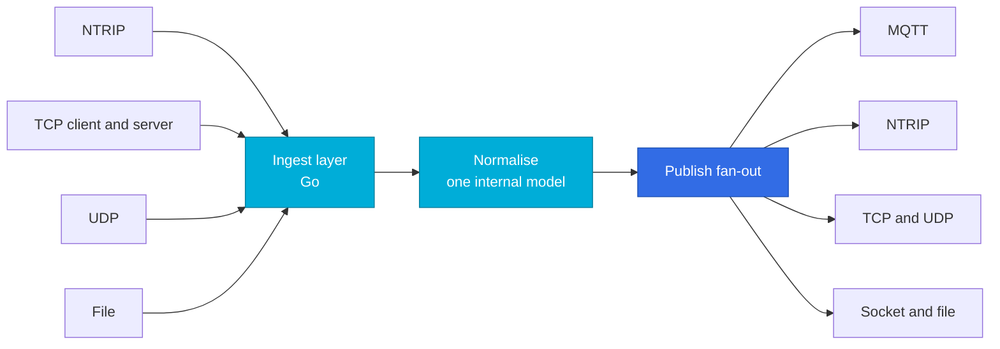

# Shivam Singh

### Backend Engineer — Go · Real-Time Streaming · Kubernetes

**Systems that stay up under load.**
Dubai, UAE · UTC+4

---

## By the numbers

| | | |
|:---:|:---:|:---:|
| **10,000+** | **15,000+** | **2 min → 2 sec** |
| concurrent streams in Go on Kubernetes | listings served under 3s, from timeouts | booking transaction latency |
| **10–20** | **~5 min** | **2×** |
| production servers on AWS EC2 | downtime per phase, Azure → AWS cutover | Smart India Hackathon wins |

---

## The system I'm known for

A real-time streaming pipeline in Go — many protocols in, one normalised model, many protocols out, holding 10,000+ concurrent streams on Kubernetes.

**The hard parts were not the happy path.** Malformed frames from one device cannot take down the listener, so bad events are isolated per event rather than per batch. Concurrent sessions stay thread-safe under sustained load. Every source identifier survives normalisation, so a problem traces back to the device that caused it.

---

## Tech

**Core**

**Streaming & messaging**

**Infrastructure**

**Data**

**Product**

---

## Experience

<b>Full-Stack Engineer</b> · Livjaza Vacation Homes Rental, Dubai · <i>May 2025 – present</i>

 

- Rebuilt search and listing infrastructure for **15,000+ listings**, from repeated timeouts to **sub-3-second** responses.
- Re-engineered booking logic to eliminate double-bookings under concurrent load — **2+ minutes → under 2 seconds**.
- Operate **10–20 production servers on AWS EC2**: self-hosted MongoDB replica sets with separated primary and secondary nodes, PostgreSQL, and tested backup and restore for both.
- Led a **phased Azure → AWS migration** — rebuilt on EC2, moved databases by full dump and restore, re-established replication, verified health before each cutover. Fully stable in three weeks, **~5 minutes downtime per phase**.
- Integrated three payment providers (Stripe, Tabby, Tamara) under PCI-compliant handling.

<b>Full-Stack Engineer</b> · Lurra Systems, Australia (remote) · <i>Mar 2024 – Apr 2025</i>

 

- Designed and built the Go streaming pipeline diagrammed above — **10,000+ concurrent streams on Kubernetes**.
- Defensive network programming throughout: per-event isolation of malformed input, thread-safe concurrent sessions, configurable limits and timeouts.
- Built API-key IoT device management with live connection maps, coverage heatmaps and real-time metrics — device onboarding from days to minutes for non-technical staff.
- Authored the full Postman API documentation; measurably reduced inbound support requests.
- Reported directly to the CEO, turning business requirements into architecture.

<b>Product Developer</b> · Central Ground Water Board, Govt. of India · <i>Aug 2023 – Feb 2024</i>

 

- Led a cross-functional team building an open-source hydro-chemical analysis platform in React and Electron — **[live on cgwb.gov.in](https://cgwb.gov.in/visualization-and-interpretation-of-hydro-chemical-data)**.
- Cut analysis time **30%** with interactive filtering, dynamic plotting and GIS-backed water-quality maps.
- Applied statistical methods and machine learning to predict contamination risk.

---

## Projects

<table>
<tr>
<td width="50%" valign="top">

### [InterviewBlitz](https://interview-blitz.vercel.app/)

Interview platform with scheduling, customised testing criteria, automated scoring and **real-time video over WebRTC**.

`React` · `Node.js` · `MongoDB` · `Express` · `WebRTC`

</td>
<td width="50%" valign="top">

### [Bloglite](https://vloglite.vercel.app/)

Social publishing platform with JWT auth, Redis caching, likes and comments.

`React` · `Node.js` · `MongoDB` · `Redis`

</td>
</tr>
</table>

<!-- PIN YOUR GO REPOS AND LIST THEM HERE, ABOVE THESE TWO.
     This section is the one recruiters judge you by. -->

---

## Recognition

🥇 **Winner — Smart India Hackathon 2023 (ISRO track)** · NTRIP caster, clients and servers for web and mobile
🥇 **Winner — Smart India Hackathon 2022 (Ministry of Jal Shakti)** · Team leader, hydro-chemical visualisation platform
🎓 **B.S. Data Science and Applications**, IIT Madras · **B.Tech Computer Science**, Bundelkhand University

---

**Open to backend and infrastructure work.**

Happy to talk about anything involving Go, streaming, or systems that have to stay up.

